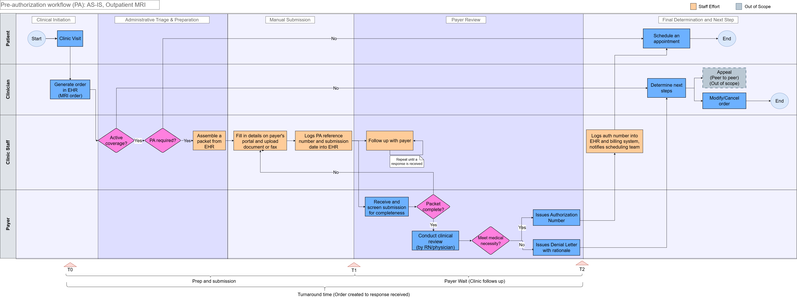

# As-Is Process and Pain Points

## How to read the swimlane

- Four lanes: Patient, Clinician, Clinic staff, Payer.
- **T0** is when the order is created in the EHR. **T1** is when the request is submitted to the payer. **T2** is when the clinic receives the response.
- Turnaround time runs from T0 to T2. Clinic staff effort is the active time on the Clinic staff lane steps, including each follow-up attempt. Waiting time is not counted.
- The appeal and peer-to-peer box is shown as an end point only. It is out of scope.
- Denials go straight to the clinician in this diagram. This is a simplification. In practice, staff often receive the response first.

## Pain points

These come from walking through the as-is flow. They are reasoned from the process and supported by general sources where noted, not measured at a real clinic.

| # | Pain point | Where in the flow | Affects |
|---|---|---|---|
| 1 | Staff look up coverage and PA rules by hand. Rules differ by payer and plan. | Active coverage? / PA required? | Staff effort |
| 2 | The packet is pulled together by hand from the EHR (notes, history, forms). | Assemble packet from EHR | Staff effort |
| 3 | Each payer has its own portal, fax, or form, so the same data is typed again. | Fill in details on payer's portal | Staff effort |
| 4 | Missing information is found only after submission, which causes rework and delay. | Packet complete? (No) | Both |
| 5 | Staff keep calling or checking the portal for status. | Follow up with payer | Both |
| 6 | The decision is typed into the EHR and billing by hand, and the scheduling team is told manually. | Logs auth number into EHR | Staff effort |
| 7 | The patient's scan waits until the response is seen and acted on. | Whole wait period | Turnaround |

## Supporting context from sources

- Manual PAs often depend on phone and fax contact, according to the CAQH Index.
- In the AMA survey, about 40% of physicians said they have staff who work only on prior authorization.
- In the AMA survey, 95% of physicians said PA delays access to necessary care.

See [sources](../01-scope/sources.md) for links and limits.

## Still to validate

- Compare the step order with a few payer or provider PA instruction pages for MRI.
- Check whether clinicians are usually pulled in for added notes or sign-off when information is missing.
- Check how payers notify clinics of decisions (portal, fax, phone, email alert).
