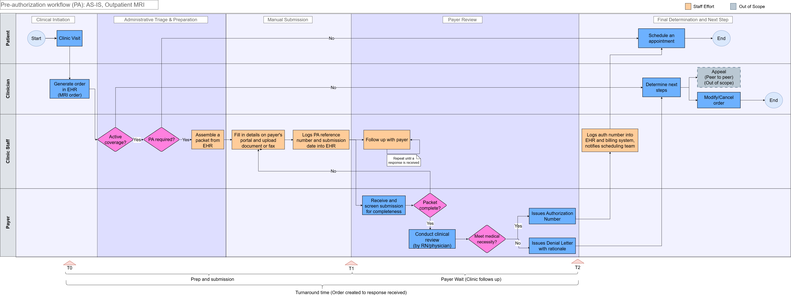

# Streamlining Prior Authorization: Outpatient MRI Orders

**Status:** In progress. The scope, as-is process, pain points, and baseline KPIs are done. The to-be design, requirements, FHIR data mapping, and risks are next.

**Author:** [add your name and LinkedIn link]

## The problem

Before an outpatient MRI, the clinic often needs prior authorization (PA) from the patient's health plan. The process is mostly manual. Staff look up the rules, build a packet, submit it by portal or fax, and keep following up until a decision comes back. This delays care and uses a lot of staff time.

## What this project looks at

One use case: an outpatient MRI order placed at a clinic, with the health plan (payer) making the decision.

**Main question:**

> How much could automated ePrior Authorization (ePA), using FHIR standards, reduce (1) the time from order creation to payer response, and (2) the clinic's staff effort and cost per PA?

## What's in this repo

| Folder | What's inside | Status |
|---|---|---|
| [01-scope](01-scope/) | One-page scope statement, sources list | Done |
| [02-as-is](02-as-is/) | Current-state swimlane, pain points | Done |
| 03-to-be | Future-state swimlane with ePA | Next |
| 04-requirements | Stakeholders, user stories, FHIR data mapping | Planned |
| [05-metrics](05-metrics/) | KPIs and as-is baseline values | Done |
| 06-risks | Risks and limits | Planned |

## A note on the numbers

This is a self-directed portfolio project. I did not work with a real clinic or real patient data. The as-is flow is built from public sources and general knowledge. The baseline numbers are reference estimates from published sources (listed in [sources](01-scope/sources.md)), not measurements. ePA should reduce manual work, not remove it. Some requests will always need clinical review.
